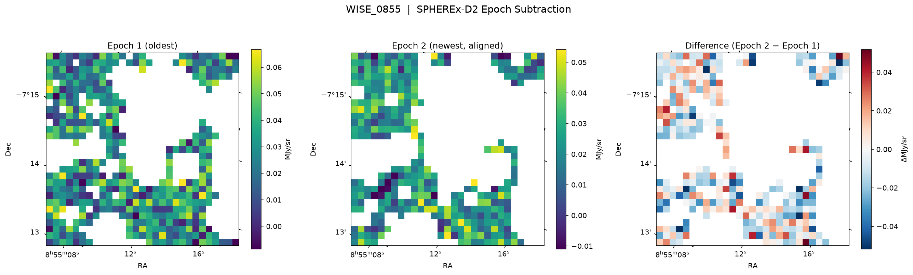

# SPHEREx Epoch Subtraction & Anomaly Discovery Engine

An end-to-end full-stack astronomical pipeline and web application for SPHEREx (Spectro-Photometer for the History of the Universe, Epoch of Reionization, and Ices Explorer) spectral imaging data.

The system queries NASA IRSA TAP, downloads multi-extension FITS (MEF) cutouts, performs zodiacal background subtraction, removes instrument glitches while preserving real astronomical sources, aligns temporal epochs onto a common celestial WCS grid using interpolation reprojection, and discovers high-significance moving or variable anomalies (dipoles).

---

## Features

- **Automated IRSA TAP Querying**: Queries the `spherex.obscore` table on `https://irsa.ipac.caltech.edu/TAP` for available spectral images.
- **DataLink Cutout Resolution**: Automatically extracts on-the-fly spatial cutout URLs from IVOA DataLink descriptors to prevent downloading full 65MB detector frames.
- **Accurate Flag Filtering**: Masks true glitches while explicitly preserving source emission (bit 21 = `2097152`) and benign calibration flags (`2`), eliminating artificial NaN holes.
- **WCS Reprojection**: High-precision astrometric grid alignment via `reproject.reproject_interp`.
- **Statistical Dipole Discovery**: Sigma-clipped background noise metrics and peak finding (`scipy.ndimage`) to flag positive (new/brightened) and negative (faded/moved) dipoles with SNR ratings.
- **Interactive Web Interface**:
  - 3-Panel Inspection View (Epoch 1, Epoch 2 Aligned, Difference Map)
  - Interactive Blink Comparator (with speed control and frame toggles)
  - Discovered Anomalies Table with filtering
  - NASA Science Target Presets (WISE 0855, Barnard's Star, Epsilon Indi B, RW Aurigae, R Draconis)

---

## Sample Subtraction Output



---

## Quickstart

### 1. Install Dependencies
```bash
pip install -r requirements.txt
```

### 2. Run the CLI Test Pipeline
```bash
python test_pipeline.py
```

### 3. Start the Web Application
```bash
uvicorn app:app --host 0.0.0.0 --port 8000
```
Then visit [http://127.0.0.1:8000](http://127.0.0.1:8000) in your browser.
